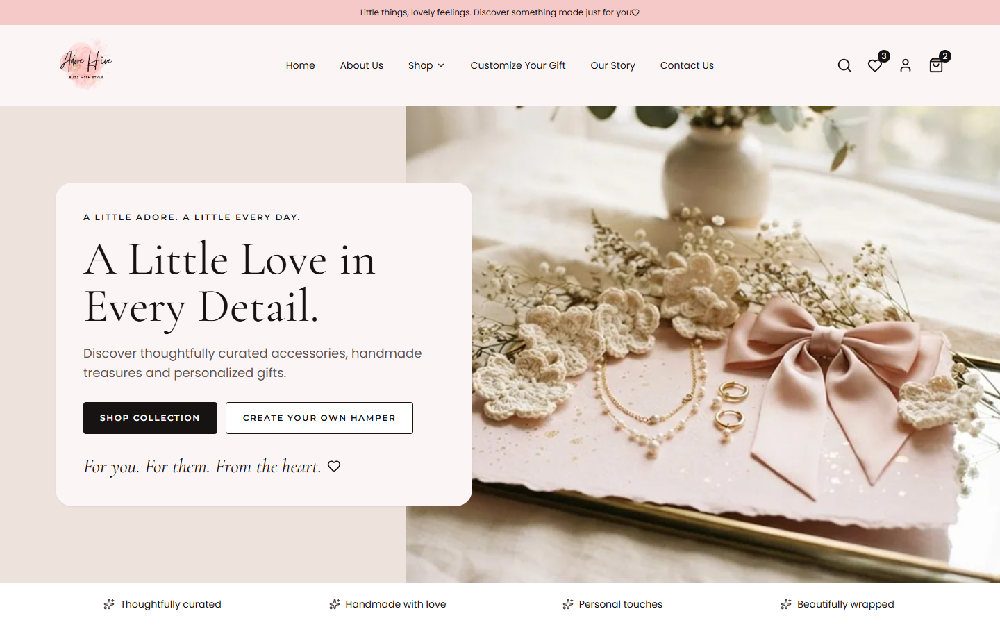
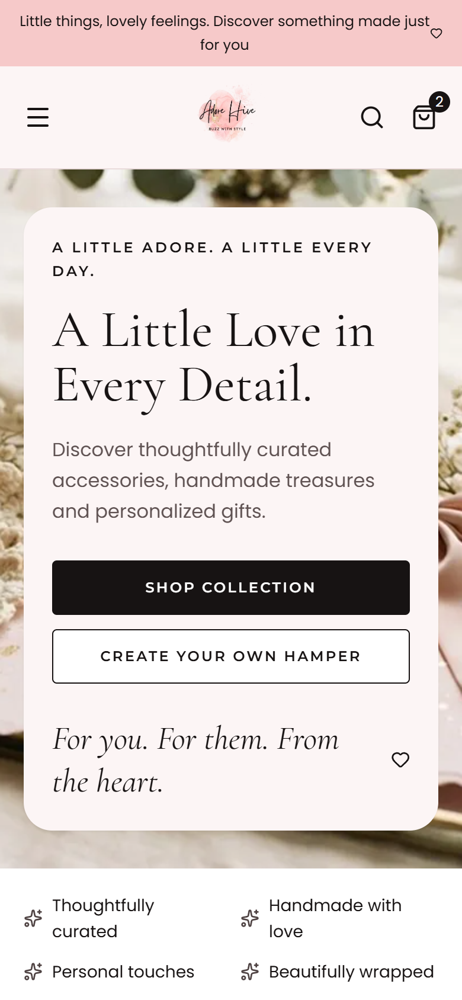
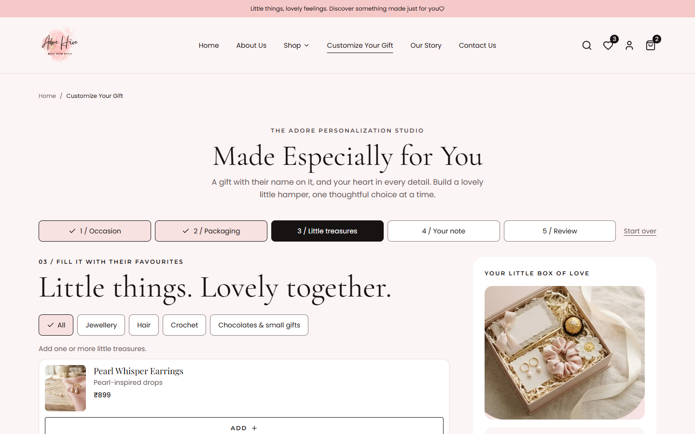
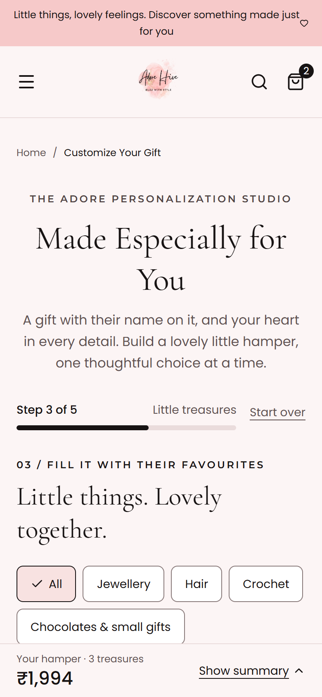
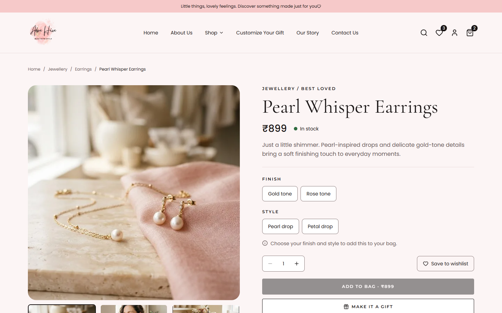
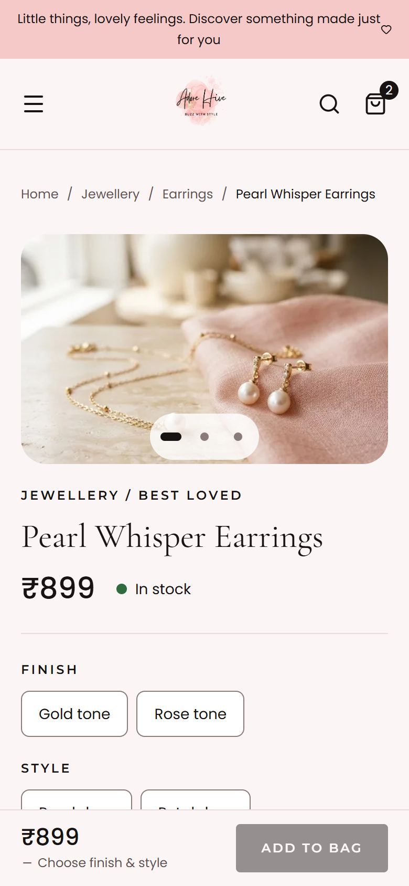
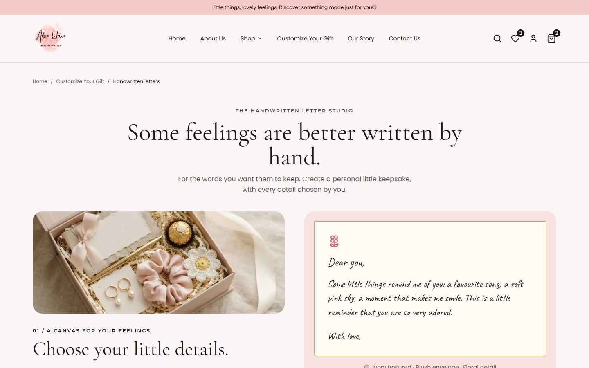
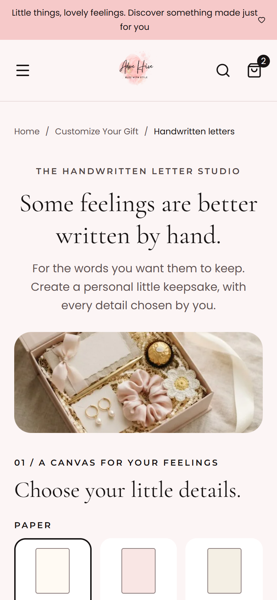

# Adore Hive

A calm, accessible storefront for jewellery, hair accessories, handmade crochet and personalized gifts, with a stepped hamper builder and a handwritten letter studio. Frontend only, ready for a backend.


| Desktop | Mobile |
| --- | --- |
|  |  |
|  |  |
|  |  |
|  |  |

More: [shop](docs/screenshots/shop-desktop.png) · [bag](docs/screenshots/bag-desktop.png) · [checkout](docs/screenshots/checkout-desktop.png) · [about](docs/screenshots/about-desktop.png)

## Features

**Browsing**
- Home with a hero, category tiles, three curated product rows and a brand story. Product rows become snap-scroll carousels on mobile.
- Shop All and four category pages driven by one listing component: collection, price range (inputs plus a two-thumb slider), colour and finish filters, sorting, subcategory chips and removable filter chips. Everything is synced to the URL, so links and the back button work.
- Search overlay with recent searches and a results page at `/search?q=`.
- Mega-menu that opens on hover, focus or click, with a close delay and Escape to dismiss.

**Buying**
- Product pages with a sticky gallery (swipeable on mobile), required options, stock states with a "Notify me" form, a gift-wrap panel, a PIN code delivery check and related products.
- Quick view on desktop, wishlist, and a bag drawer that shares its line component and totals logic with the bag page.
- Free-shipping progress, order notes, and a mobile sticky checkout bar.
- Checkout with inline validation, an error summary, a draft kept in `sessionStorage`, a collapsible mobile summary and a mock payment step. Orders are saved and shown on a confirmation page.
- Account area: sign in and create account (mock), orders, saved addresses (add, edit, delete, default, used to prefill checkout), wishlist and details.

**Making things personal**
- Hamper studio: five steps (occasion, packaging, little treasures, note, review) with the step kept in the URL, locked steps, a live price summary, a draft saved in `localStorage`, and a hamper line that stores its contents in the bag and orders.
- Letter studio: visual paper, envelope and decoration swatches, a live handwritten-style preview, a character counter, and a choice to sell the letter alone or attach it to a hamper.

**Quality**
- Route-level code splitting, image skeletons, explicit image sizes, per-route titles, descriptions and Open Graph tags, `robots.txt`, `sitemap.xml` and a `vercel.json` rewrite for deep links.
- Persisted bag, wishlist, hamper and letter state, with guards against removed products and corrupt values.

## Tech stack

React 18, TypeScript (strict), Vite, Tailwind CSS, React Router, Zustand (with `persist`), lucide-react. Dev tooling: axe-core and playwright-core for the accessibility sweep, screenshots and checkout Lighthouse run. There is no backend: data lives in typed mock modules.

## Project structure

```
src/
  components/
    ui/          shared building blocks: Button, Field, Drawer, Modal, ProductCard, Tabs, Accordion...
    layout/      header, shop menu, mobile menu, search, bag drawer, footer, page layouts
    bag/         bag line and order summary, shared by the drawer, bag page and checkout
    product/     gallery, option picker, gift panel, delivery check, notify form
    studio/      step indicator, hamper summary, request form
    account/     saved addresses
  config/        site details, shop rules (shipping, gift wrap, studio prices), Indian states
  data/          typed mock catalogue, navigation, reviews, image map
  lib/           pure logic: filtering, bag totals, hamper pricing, validation, SEO hook
  pages/         one file per route (lazy loaded); policies/ holds the legal pages
  store/         Zustand stores: bag, wishlist, search, ui, toast, auth, orders, hamper, letter
scripts/         a11y sweep, screenshots, sitemap, Lighthouse runs
public/          images, logo, icons, robots.txt, sitemap.xml
docs/screenshots generated images used above
```

## Getting started

```bash
npm install
npm run dev        # http://localhost:5173
```

Requires Node 18 or newer. The scripts that drive a browser (`a11y`, `screenshots`, `lighthouse`) need Edge or Chrome installed; set `CHROME_PATH` if it is not found automatically.

## Configuration

Copy `.env.example` to `.env.local` (or set the variables in your host). Every flag defaults to off, so a fresh deploy is private and shows no sample content.

| Variable | Default | What it does |
| --- | --- | --- |
| `VITE_SHOW_SAMPLE_REVIEWS` | `false` | Show the sample customer reviews (home page and product pages). When off, the sections are not rendered at all. Keep it off until you have real, approved reviews. |
| `VITE_INDEXABLE` | `false` | Allow search engines to index the site. When off, every page carries `noindex, nofollow`, `robots.txt` disallows everything and no `sitemap.xml` is produced. |
| `SITE_URL` | `https://adorehive.in` | Public origin for canonical links, social images and the sitemap. |

**Switching indexing on at launch:** set `VITE_INDEXABLE=true` and `SITE_URL=https://your-domain` in the production environment and rebuild (`npm run build`). The build then writes `sitemap.xml` and a `robots.txt` that allows crawling, drops the `noindex` meta tag, and the app reports `index, follow` on public pages (cart, checkout, account and search stay `noindex`). Variables are read at build time, so changing them needs a new deploy.

## Scripts

| Script | What it does |
| --- | --- |
| `npm run dev` | Start the Vite dev server |
| `npm run build` | Write `robots.txt` (and `sitemap.xml` when indexing is on), type-check (`tsc --noEmit`) and build to `dist/` |
| `npm run preview` | Serve the production build locally |
| `npm run a11y` | Load every route and key overlay at 390, 834 and 1440 px and report axe violations (needs the dev server running) |
| `npm run screenshots` | Regenerate `docs/screenshots/` |
| `npm run lighthouse` | Mobile Lighthouse on home, shop, a product page and checkout (run against `npm run preview` on port 4173) |

## Design decisions

- **Tokens.** Colours, fonts, radii and the type scale live in `tailwind.config.js` as semantic tokens (`page`, `blush`, `ink`, `muted`...). Fonts: Cormorant Garamond for headings, Playfair Display for product names, Poppins for body text, Montserrat for uppercase labels and buttons, Caveat for the letter preview.
- **Mobile first, with fixes over the original layouts.** Tall product grids became snap carousels, filters moved into a bottom sheet, the checkout summary collapses to the top, the hamper summary is a bottom bar, and placeholder copy is replaced with real content. The tablet hero keeps its text fully inside a solid panel.
- **One source of truth.** Contact details live in `src/config/site.ts`; shipping, gift wrap and studio prices in `src/config/shop.ts`. Bag maths is a single pure function used everywhere.
- **No silent defaults.** Products with options never add a default; the visitor chooses, or goes to the product page.
- **State you can trust.** Persisted stores rebuild themselves on load, dropping unknown products and clamping quantities.

## Accessibility

- Skip link, landmarks, one `h1` per page and a heading outline checked by axe.
- WCAG AA contrast: muted and eyebrow text are darkened rather than matched to the original greys, and text over photos always sits on a solid panel.
- 44 px minimum tap targets, visible focus rings (including scrollable carousels), and text never below 12 px.
- Focus-trapped dialogs and drawers that restore focus, Escape to close, `aria-live` toasts, accessible tabs and step indicators, and `prefers-reduced-motion` respected.
- Forms validate inline on blur, focus the first invalid field on submit and show an error summary where it helps.
- `npm run a11y` audits 100+ page states and currently reports no violations.

## Performance

Mobile Lighthouse against the production build:

| Page | Performance | Accessibility | Best practices | SEO |
| --- | --- | --- | --- | --- |
| Home | 96 | 100 | 100 | 100 |
| Shop All | 96 | 100 | 100 | 100 |
| Product | 99 | 100 | 100 | 100 |
| Checkout | 99 | 100 | 100 | 69 |

Checkout is deliberately `noindex`, which is the only reason its SEO score is lower. Code splitting took the main JavaScript bundle from 341 kB (102 kB gzip) to 241 kB (76 kB gzip) before counting the new studios, with each page loaded as its own small chunk.

## Known limitations and roadmap

- **No backend yet.** Orders, accounts, the newsletter, contact and request forms are all mock. Accounts use a salted PBKDF2 digest in `localStorage` purely so the flow behaves realistically; it is not secure authentication.
- **Mock payments.** Checkout never talks to a payment gateway and stores no card or UPI details. The integration point is `src/lib/payment.ts`.
- **Placeholder photography.** Product, banner and lifestyle images are temporary, some low resolution. Swap them in `src/data/images.ts`.
- **Mock prices and stock.** All prices, stock states and shipping rules are sample values (marked with TODO comments).
- **Policy copy needs review.** The shipping, returns, privacy and terms pages are drafts and must be reviewed before launch.
- **Single-page app.** Titles and meta tags are set at runtime. For best social previews and crawling, add pre-rendering or server rendering.
- **Roadmap:** real catalogue and CMS, payment gateway, authentication and email, order management, product reviews, pre-rendering.

## Contact

Adore Hive, Indore, Madhya Pradesh 452010 · +91 76971 07355 · [Instagram](https://www.instagram.com/adore.hive) · [WhatsApp](https://wa.me/917697107355)
